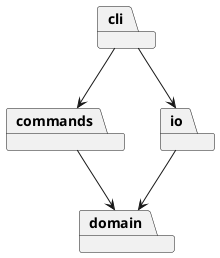

# SVG 编辑器 Phase 1

## 架构方案

计划分为 domain（图形和文档）、commands（命令及历史）、io（SVG 文件）、cli（输入输出），入口负责组装。采用 Command 封装每次编辑，Composite 统一容器和叶子，工厂集中创建类型。依赖方向为 cli → commands/domain/io，commands → domain，io → domain，domain 不依赖上层。

变化点：未来图形插件从工厂扩展；未来 GUI 复用命令层；本阶段使用文档快照实现原子撤销，较大文档可改为增量逆操作。命令名和图形类型两个分派点集中管理，属于后续插件化阶段待重构项。

## 过程记录

1. 读取原始要求，确认 box 不属于本阶段范围。
2. 检查工作区发现已有其他项目，因此创建独立嵌套仓库，避免将无关文件提交。
3. 当前记录为架构初稿；实现和验证完成后继续补充实际发现与修订。

## 一致性自查

尚未完成，最终实现后填写，不预先宣称通过。

## 质量保证手段

计划使用 Node 测试覆盖命令历史、失败原子性、层级操作和 SVG 往返，并运行 TypeScript 类型检查。
