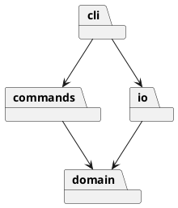

# SVG 编辑器 Phase 1

## 架构方案

计划分为 domain（图形和文档）、commands（命令及历史）、io（SVG 文件）、cli（输入输出），入口负责组装。采用 Command 封装每次编辑，Composite 统一容器和叶子，工厂集中创建类型。依赖方向为 cli → commands/domain/io，commands → domain，io → domain，domain 不依赖上层。

变化点：未来图形插件从工厂扩展；未来 GUI 复用命令层；本阶段使用文档快照实现原子撤销，较大文档可改为增量逆操作。命令名和图形类型两个分派点集中管理，属于后续插件化阶段待重构项。

## 过程记录

1. 读取原始要求，确认 box 不属于本阶段范围。
2. 检查工作区发现已有其他项目，因此创建独立嵌套仓库，避免将无关文件提交。
3. 随后实现领域模型、命令历史和 CLI/IO，按阶段分别提交。
4. 首轮测试发现 Node 的 TypeScript 类型擦除模式不支持构造函数参数属性；改为显式字段赋值，类型检查和测试通过。
5. 将初期平铺的源码迁移到 domain/commands/io/cli，修正所有导入。
6. 外部 SVG 缺 id 时先收集全文显式 id，再分配自动 id，避免与后续节点冲突；测试覆盖 rect2/rect1 场景。
7. 下载依赖时 Node 网络解析失败，通过 PowerShell 下载公开 npm 包完成本地验证。GitHub 推送仍因 github.com 域名解析失败，未声称远程已交付。

## 一致性自查

实际目录与方案一致；初期平铺仅为开发中间态，已在步骤 5 修订。抽样检查：domain/Shape.ts 无外部模块依赖；commands/History.ts 仅依赖同层及 domain；io/SvgCodec.ts 依赖 domain 和 XML 库；cli/Editor.ts 组装命令、领域对象与文件适配器。不存在 domain 向 cli/io/commands 的反向依赖。入口 src/main.ts 只负责 REPL。

Command：EditCommand 封装编辑行为和前后快照，History 管理两个栈；失败只丢弃工作副本。Composite：Group 继承 Shape，move/scale 对 children 递归，不按标签分派。Factory：ShapeFactory 统一构造六种图形。命令名分派仅在 Editor，类型名分派仅在 ShapeFactory。

已知取舍：快照开销随文档大小和历史长度增长；本阶段未设置历史长度上限。外部 SVG 读取面向六种内置元素及白名单属性，不支持 transform、path、CSS、复杂 text/tspan；遇到不支持属性或元素会明确拒绝，保留原文档。box 不在本阶段范围。

## 质量保证手段

已通过 7 组 Node 自动测试，以及 tsc --noEmit 严格类型检查。测试覆盖六种图形、递归移动缩放、编辑历史、显示跳过历史、IO 屏障、失败不影响状态与 redo、分组顺序、循环防护、解组限制、z-order、子树删除恢复、中文及 XML 字符转义、自动 id、重复 id、无效 XML、未知类型与引号错误、读写失败和默认保存路径。

examples/flowchart.txt 已真实回放并生成 examples/flowchart.svg，含 8 个元素。GitHub Actions 会在推送与 PR 时运行同样的测试和类型检查。实际远程执行结果须推送后确认。
